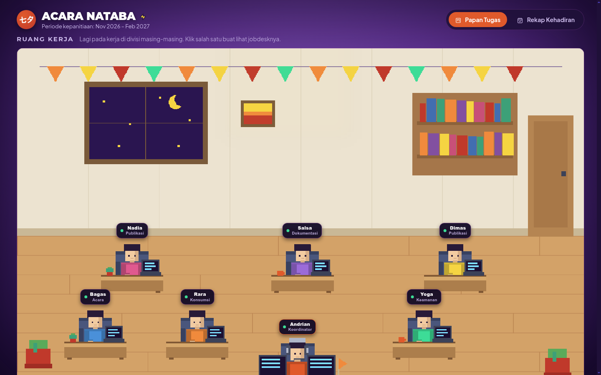

# ◆ Acara Nataba — Papan Kinerja Panitia

**🔗 Live:** https://an-maz.github.io/kinerja-panitia/



Dashboard statis buat memantau kinerja tim kepanitiaan **Acara Nataba**: **kanban tugas** (To Do → In Progress → Done), **rekap kehadiran** dengan perhitungan persentase, dan **pengingat jadwal rapat** berupa hitung mundur live. Data diinput lewat file JSON, jadi gak perlu backend — cukup push, langsung ke-deploy.

> Dibangun dengan vanilla HTML / CSS / JavaScript, tanpa framework dan tanpa build step.

## ✨ Fitur

- **Kanban 3 kolom** — To Do, In Progress, Done; tiap kartu nunjukin divisi, PIC, deadline, prioritas, dan progres checklist mini.
- **Detail tugas** — klik kartu, muncul modal: deskripsi, checklist, catatan, dan flag **Terlambat** kalau deadline lewat tapi belum selesai.
- **Rekap kehadiran** — tabel per anggota: hadir / izin / sakit / alfa + bar persentase kehadiran, plus total dan rata-rata tim.
- **Pengingat rapat + countdown live** — strip "Jadwal Rapat" di atas papan dengan hitung mundur per detik. Rapat yang tinggal **≤ 1 hari** menyala oranye (state urgent), dan **popup reminder muncul otomatis setiap halaman dibuka** sampai kamu tutup.
- **Ringkasan atas** — total tugas, % selesai, yang sedang dikerjakan, tugas terlambat, jumlah anggota, kehadiran rata-rata.
- **Ikon SVG ala Lucide** — semua emoji di UI diganti icon stroke SVG (konsisten kayak icon di React), termasuk tombol close dan centang checklist.
- **Dekorasi crop dari poster acara** — glyph **七夕** di logo lingkaran merah dan bintang di header "Jadwal Rapat" di-crop langsung dari desain poster (file di `assets/`, background sudah transparan).
- **Scene pixel art "Ruang Kerja"** — ilustrasi kantor retro di halaman awal: 7 panitia duduk di meja masing-masing (animasi ketik dua frame pakai CSS `steps()`), pill nama + divisi di atas kepala, meja koordinator beda setup (2 monitor + headset). **Klik karakter → popup jobdesk** (role, divisi, poin jobdesk, progres tugas). Spritenya digenerate script Python di `tools/make-pixel-assets.py`.
- **Karakter 3D idle** — robot kecil di pojok kanan bawah (three.js), kedip, goyang, dan nengok ngikutin kursor.

## 📁 Struktur

```
├── index.html          # entry point
├── css/style.css       # tema pop-art festival (minimalis)
├── js/app.js           # render kanban, modal, rekap kehadiran, countdown, scene Ruang Kerja
├── js/character.js     # karakter 3D idle (three.js via CDN)
├── assets/             # elemen crop dari poster (transparan)
│   ├── kanji-nataba.png
│   ├── decor-star.png
│   └── pixel/          # sprite pixel art (room.png + 2 frame per orang)
├── tools/
│   └── make-pixel-assets.py  # generator sprite pixel art
└── data/
    ├── tasks.json      # ← input tugas tim di sini
    ├── attendance.json # ← input kehadiran di sini
    ├── team.json       # ← data anggota: nama, role, divisi, posisi meja, jobdesk
    └── meetings.json   # ← jadwal rapat di sini
```

## 📝 Cara input data

### Tugas (`data/tasks.json`)

```json
{
  "event": "Nama Acara",
  "period": "Periode kepanitiaan",
  "tasks": [
    {
      "id": "T-11",
      "title": "Judul tugas",
      "division": "Acara",
      "pic": "Nama PIC",
      "status": "todo",          // todo | in_progress | done
      "priority": "high",        // high | medium | low
      "deadline": "2026-12-01",
      "description": "Penjelasan singkat.",
      "notes": "Update terakhir.",
      "checklist": [
        { "item": "Sub-tugas 1", "done": false }
      ]
    }
  ]
}
```

### Kehadiran (`data/attendance.json`)

```json
{
  "period": "November 2026",
  "members": [
    {
      "name": "Nama Anggota",
      "division": "Divisi",
      "records": { "2026-11-22": "hadir" }   // hadir | izin | sakit | alfa
    }
  ]
}
```

**Aturan hitung** (bisa diubah di `js/app.js`, fungsi `attendanceSummary`):

- Total sesi = gabungan semua tanggal yang muncul di seluruh anggota.
- Anggota yang gak mencatat di sebuah tanggal = **alfa**.
- `% kehadiran = hadir / total sesi × 100`.
- Rata-rata tim = rerata `% kehadiran` seluruh anggota.

### Rapat (`data/meetings.json`)

```json
{
  "meetings": [
    {
      "title": "Rapat Koordinasi Divisi",
      "datetime": "2026-11-24T19:00",
      "place": "Aula Utama",
      "note": "Bawa draft rundown."
    }
  ]
}
```

Hitung mundur jalan per detik. Ambang "≤ 1 hari" buat state urgent dan popup ada di `js/app.js` (`DAY_MS`) — kalau mau ganti jadi 3 hari, ubah konstantanya.

**Data di folder `data/` saat ini masih contoh placeholder** — ganti dengan data kepanitiaan asli kamu.

## 🖥 Menjalankan lokal

`fetch()` diblokir kalau dibuka langsung dari `file://`, jadi jalankan server lokal dulu:

```bash
python3 -m http.server 8000
# buka http://localhost:8000
```

## 🚀 Deploy (GitHub Pages)

1. Push repo ke GitHub.
2. **Settings → Pages → Source: Deploy from a branch**, pilih `main` / `/ (root)`.
3. Selesai — situs live di `https://<username>.github.io/<repo>/`.

Tiap kali edit JSON dan push, situsnya ikut ke-update otomatis.

## 🧰 Tech

| Layer | Teknologi |
|---|---|
| Frontend | HTML, CSS, JavaScript vanilla (ES2022) |
| 3D | three.js r160 (CDN, ES module) |
| Data | JSON statis |
| Deploy | GitHub Pages (gratis) |